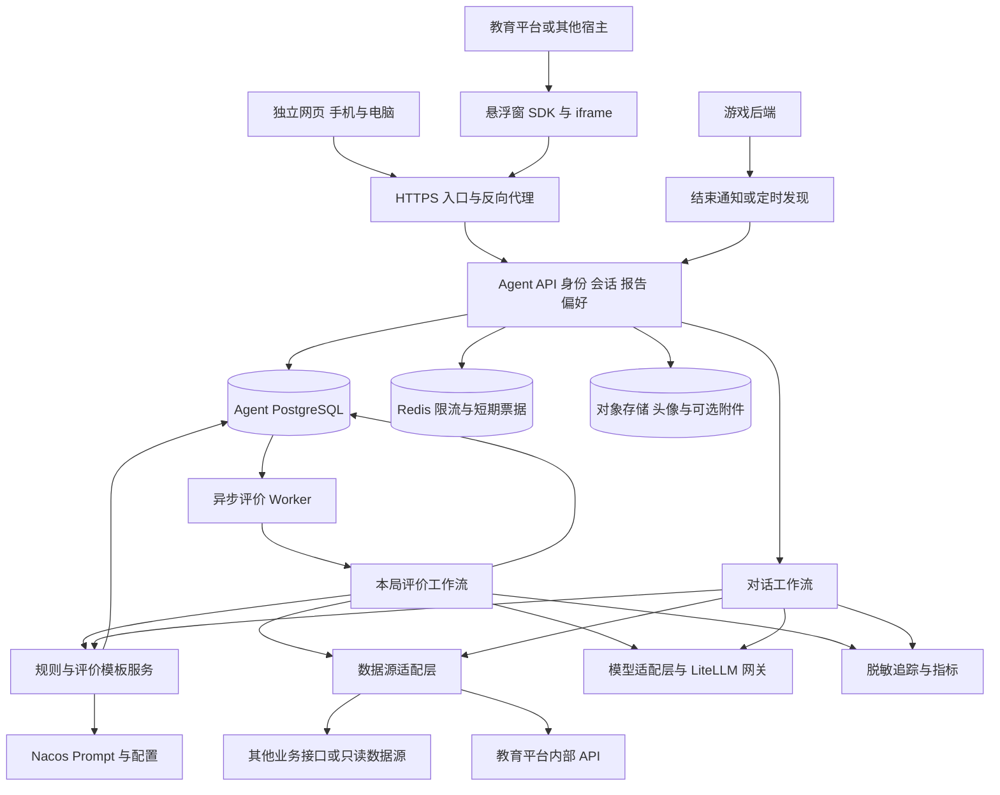
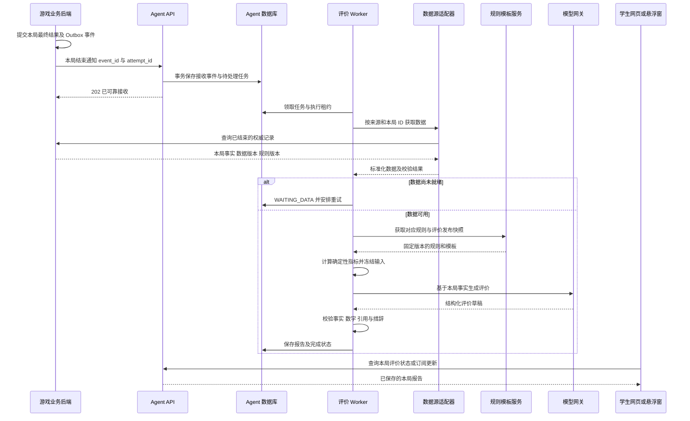
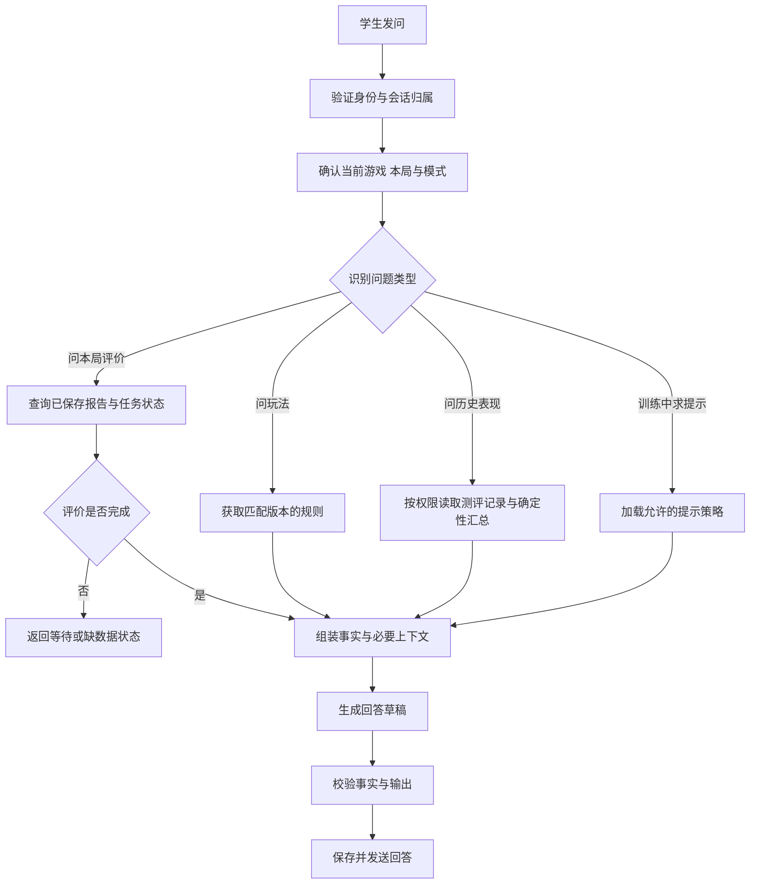

# 学生游戏测评 Agent 后端架构方案 V1

版本日期：2026 年 10 月 26 日。

本方案面向一个可独立部署的学生游戏测评应用，提供独立网页，并通过悬浮窗嵌入教育平台、游戏页面或其他宿主应用；移动端和电脑端共用后端 API。核心业务是：**每局测评游戏结束后，自动获取本局数据、生成评价、保存报告，学生也可以继续向 Agent 提问。**

建议采用 **独立 FastAPI 应用 + LangGraph 流程编排 + 异步评价 Worker + 数据源适配层 + Nacos 模板与配置管理**。教育平台继续负责账号、学校授权、游戏成绩和等级解锁；Agent 应用负责数据整合、评价生成、对话和报告展示。第一期采用模块化单体，API 与 Worker 使用同一代码库、独立进程部署。

本文件是设计方案，文中的新接口、表名、配置和状态均为拟议契约，不表示已经实现。本次只新增方案文件。

## 1 需求依据与范围

### 1.1 已明确的需求

| 需求 | 后端设计含义 |
| --- | --- |
| Agent 独立部署，拥有独立网页 | 独立镜像、域名、API、数据存储和发布流程，通过接口与宿主集成 |
| 支持其他应用中的悬浮窗 | 提供 Widget 接入配置、短期登录票据、宿主上下文协议 |
| 支持手机和电脑 | 同一身份体系、会话、报告接口；界面自适应由前端完成 |
| 每次游戏结束后评价 | 每局测评结束即触发一次自动评价，无需等待学生发问或完成全部游戏 |
| 本局数据可能来自其他接口或位置 | 通过统一数据源适配层接入，生成流程不绑定某一个业务数据库 |
| Nacos Prompt 可作为游戏规则模板 | 按游戏与规则版本管理玩法说明，配合评价模板和发布快照使用 |
| 文档规定训练模式不收集数据 | 不将训练局写入测评记录、评价任务、报告或排行榜；训练解锁状态另见第 10 节 |
| 新手、能手、大师依次解锁，达到铜级可进入下一级 | 教育后端按确定性规则判断，Agent 仅查询和解释 |
| 悬浮窗初期包含对话与个人学伴自定义 | 支持名字、头像等偏好；语音能力作为可选扩展 |
| 个人报告按册、按游戏查看每次记录 | 每局评价独立保存，提供历史分页；册次汇总由这些记录派生 |

本方案将最新补充理解为“每次**测评模式**游戏结束后自动评价”，沿用原文档对训练模式的约定。若训练局也需要正式评价，需要单独调整采集范围。

### 1.2 两类主要入口

1. **自动评价入口**：游戏结束通知或同步任务发现一条已结束记录 → 拉取本局数据 → 生成本局评价 → 报告可查询。
2. **主动对话入口**：学生询问玩法、查看本局表现、追问改进方法 → 校验权限 → 获取规则和已验证数据 → 回答。

两个入口共用规则管理、数据适配、指标计算、模型调用与审计能力。自动评价是主流程，对话是补充。

## 2 与现有项目的关系

### 2.1 参考项目可以复用的能力

已阅读 `/Users/a123/D盘/学习/project/ai-infrastructure-main` 的代码，实际存在以下基础：

| 现有能力 | 代码位置 | 在新应用中的用法 |
| --- | --- | --- |
| Nacos Prompt 查询 | `config/nacos/nacos_prompt.py` | 复用客户端结构，扩展为返回版本、内容摘要、变量定义及完整快照 |
| AgentSpec 与关联 Prompt | `config/nacos/nacos_agent_spec.py`、`nacos_schemas.py` | 复用配置建模思路，增加场景路由和不可变发布清单 |
| Agent 工厂 | `agents/agent_factory.py` | 提取模型与工具装配方式，按请求传入不可变配置 |
| 模型创建 | `utils/create_model.py` | 复用模型适配层，通过网关切换公有 API 或内网模型 |
| 调用追踪 | `utils/trace_wrapper.py` | 复用 Langfuse 追踪思路，增加 attempt、evaluation、规则版本信息 |
| FastAPI 扩展与 LangGraph | `app/main.py`、`langgraph.json` | 复用技术栈，新增本应用的业务 API 和确定性工作流 |

参考项目的依赖文件固定 Python 3.13.11；Compose 中 Nacos 镜像为 `v3.2.4-slim`。正式实现应以验收通过的锁文件和镜像版本为准，不直接使用浮动版本。

### 2.2 需要按业务重新设计的部分

- 现有鉴权使用 `MOCK_USER`，不能直接作为学生生产身份体系；当前自定义路由配置也不能直接代表本应用接口已经受保护。
- 当前 Prompt 查询固定 `production` 标签、返回纯字符串，失败会返回空字符串；需要改为版本快照、严格校验和明确失败语义。
- 当前配置采用进程内缓存与后台刷新，不保证多个 Prompt 在同一次请求中属于同一个发布版本；需要发布清单和整包快照。
- 工厂实例持有可变 `self.agent_config`；扩展成多学校、多游戏后，应避免并发请求共享可变配置。
- 当前工厂默认使用 `SandboxBackend`，配置读取路径还会同步 Skill 到沙箱。第一期不继承这些依赖，改成无沙箱的测评工作流。
- 学生测评场景首期提供固定、只读的业务工具；网页搜索、代码执行、文件系统和部署工具不进入工具白名单。

### 2.3 与当前教育平台对接

当前工作区已有 `education-admin`，采用若依、Spring Boot、MySQL 与 Redis，已有学校/班级范围、登录状态校验、资源授权、游戏入口票据和学习业务。推荐将它作为第一期身份及教育业务的权威来源。

**Agent 不直连若依 Redis 解析登录状态，也不直接修改教育平台表。** 新增内部身份校验、测评数据查询和结束事件接口，由教育平台执行现有权限逻辑。后续其他应用接入时，增加对应适配器。

第一期选择 **FastAPI 内嵌 LangGraph 库**，由应用管理 PostgreSQL Checkpointer 和任务生命周期；不同时引入第二套 Agent Server 会话与任务系统。若后续迁移至 Agent Server，应统一迁移持久化、鉴权和运行状态的归属，避免两套系统分别管理同一任务。

## 3 总体架构



以上是逻辑模块，不要求每个模块部署成独立微服务。第一期只拆 `agent-api` 与 `agent-worker` 两类业务进程；数据源、规则、指标与工作流作为内部模块运行。

| 模块 | 职责 | 数据归属 |
| --- | --- | --- |
| 接入与身份 | 接入应用登记、票据交换、会话、学校及用户范围校验 | Agent 身份映射；教育账号仍归宿主 |
| 数据源适配层 | 拉取、归一化、验证、记录来源与数据版本 | 来源索引及必要的本局快照 |
| 规则模板服务 | Nacos 拉取、模板变量校验、发布包缓存、历史版本读取 | 模板在 Nacos；运行快照在 Agent 库 |
| 评价工作流 | 每局自动评价、指标计算、模型生成、校验、降级 | 评价任务及报告 |
| 对话工作流 | 理解问题、读取已授权事实、回答及追问 | 会话和有限期消息 |
| 报告服务 | 本局报告、历史记录、册次与游戏聚合 | 报告和可重建的汇总 |
| 业务权威服务 | 游戏规则执行、徽章、是否通关、积分、解锁 | 教育/游戏业务后端 |

## 4 游戏结束后的自动评价流程

### 4.1 首选接入方式

**游戏后端先提交本局结果，再通过事务 Outbox 投递结束事件；Agent 接收事件后按本局 ID 拉取最终数据。** 事件只负责告知“哪一局结束了”，完整数据由权威接口返回。没有事件能力的系统可先采用定时拉取。



学生关闭页面后，评价仍继续执行。重新登录、打开悬浮窗或进入报告页时，可获取同一份结果。

### 4.2 从结束到报告的步骤

| 步骤 | 处理内容 | 输出 |
| --- | --- | --- |
| 1 接收触发 | 校验来源应用、签名或服务凭据、时间戳、事件格式 | 可追溯的接收事件 |
| 2 去重与初筛 | 同一事件不重复入队；可信事件已注明训练模式时直接跳过，否则先获取数据确认 | 待处理任务或明确跳过 |
| 3 获取本局数据 | 根据 `source_id + source_attempt_id` 调用适配器 | 本局记录或暂未就绪 |
| 4 确认身份归属 | 以权威用户映射确认学生、学校及来源，不信任浏览器提交的用户 ID | 确认的评价对象 |
| 5 校验与归一化 | 确认已结束、测评模式、版本和字段；标记缺失及异常 | 标准事实快照 |
| 6 获取规则 | 按实际游戏规则版本读取玩法；按评价发布版本读取分析模板 | 不可变规则及模板快照 |
| 7 计算指标 | 计算可比较的步数差、效率等；选择徽章建议分支 | 确定性派生事实 |
| 8 调用模型 | 输入最少必要事实，要求返回符合 Schema 的评价 | 评价草稿 |
| 9 校验与降级 | 检查数字、徽章、事实和缺字段；失败时有限修复或模板兜底 | 可交付的评价 |
| 10 保存与通知 | 原子保存报告、状态、版本；客户端获得更新 | 可查询的本局报告 |

“每局”指一条独立且最终完成的测评记录，包括未通关的有效测评局。中途退出、超时或作废记录是否生成报告，采用来源系统状态映射，产品确认前默认不当作完整测评结果。

### 4.3 任务状态及重试

```text
RECEIVED → FETCHING → READY → EVALUATING → VALIDATING → COMPLETED
                 ↘ WAITING_DATA → 到期重新获取
                 ↘ INVALID_DATA → 数据修正后重新触发
EVALUATING / VALIDATING → RETRY_WAIT → 有限重试
                      ↘ COMPLETED_WITH_FALLBACK
超过数据等待期限或不可恢复错误 → FAILED → 人工或补偿任务重新处理
训练局 → SKIPPED_TRAINING
```

- `WAITING_DATA` 用于通知先到、数据后落库的情况，不立即给学生返回错误结论。
- 按配置退避重试；例如 2、5、15、60 秒后继续，再进入低频补偿。最大等待时间和次数按数据源设置，不无限重试。
- 模型超时且已有完整可信数据时，可生成固定模板评价；数据不可信或关键字段缺失时，不能用模板伪造完整测评报告。
- Worker 使用数据库领取、租约和心跳；进程退出后任务可被重新领取。报告写入使用唯一约束，处理重复执行。
- API 返回 202 的前提是事件与待处理任务已经持久化，不以“内存中已启动异步函数”作为可靠接收。

## 5 外部数据来源适配

### 5.1 可支持的来源

| 来源 | 触发与获取方式 | 建议 |
| --- | --- | --- |
| 外部 HTTP API | 结束通知携带本局 ID，Worker 按 ID 查询 | 第一优先，业务边界清楚 |
| 后端完整回调 | 受信任后端发送完整最终结果 | 可减少一次查询，但仍需校验来源与版本 |
| 消息队列 | 消费已结束事件，必要时再拉详情 | 已有 MQ 的系统直接适配，不为首期单独引入 |
| 定时拉取接口 | 按更新时间/游标发现新增或修订记录 | 无回调时的首期方案，也是补偿手段 |
| 只读数据库视图 | 受控账号读取约定视图，不跨库写入 | 无接口时的过渡方式，需明确表结构和权限 |
| 文件或对象存储 | 有清单、版本和归属信息的 JSON/CSV 导入 | 适合历史补评，不保证即时评价 |

这是适配范围设计；首期只实现实际数据源需要的一种主适配器及补偿方式，不要求同时完成所有连接器。

### 5.2 统一适配器契约

```text
fetch_attempt(source_attempt_id) → FetchResult
list_changed_attempts(cursor, overlap_window) → records + next_cursor
normalize(raw_record) → CanonicalAttempt
validate_origin_and_record(record) → ValidationResult
```

`FetchResult` 区分 `READY`、`NOT_READY`、`NOT_FOUND`、`AUTH_FAILED`、`INVALID_DATA` 和 `TRANSIENT_ERROR`。适配器输出统一事实模型，后续流程不感知外部接口的字段命名和数据库结构。

每个数据源配置 `app_id`、`source_id`、适配器类型、凭据引用、可信级别、状态映射、字段映射、时间单位、时区、重试策略及最终结果判定规则。外部接口地址由服务端配置，学生或模型不能传入任意 URL 供服务器抓取。

定时拉取使用“更新时间 + 稳定 ID”的分页游标和重叠时间窗，并对每条记录去重；成功持久化本页任务后再推进游标，避免漏掉同一时间戳、迟到记录或处理失败的数据。来源必须提供可稳定标识本局的 ID；没有时，需要先与来源约定标识，不能随意用结束时间代替。

### 5.3 标准本局事实示例

以下是字段结构示例，数字仅展示数据形态，不是游戏评分阈值。

```json
{
  "schema_version": "1",
  "app_id": "education-platform",
  "source_id": "assessment-api",
  "source_attempt_id": "attempt-example-001",
  "source_revision": "1",
  "student_ref": "source-student-001",
  "school_ref": "source-school-001",
  "game_code": "eight-pieces",
  "game_type": "SINGLE_PUZZLE",
  "volume_no": 5,
  "mode": "ASSESSMENT",
  "difficulty": "NOVICE",
  "status": "FINISHED",
  "duration_ms": 83000,
  "badge": "BRONZE",
  "passed": true,
  "actual_steps": 36,
  "optimal_steps": 28,
  "ended_at": "2026-10-26T02:00:00Z",
  "game_rule_version": "example-rule-v1",
  "scoring_rule_version": "example-score-v1",
  "validation_status": "VERIFIED_BY_SOURCE"
}
```

除文档要求的册号、难度、总耗时、徽章、是否通关、实际步数、理论最优步数、结束时间外，还必须有游戏标识、本局 ID、学生归属、模式和数据版本，才能正确关联和去重。数据库按 UTC 保存时间，面向学生按 Asia/Shanghai 展示；耗时统一存毫秒，展示时再转秒。

### 5.4 数据可信与缺失处理

- **可信来源**：业务后端已经验证过的最终结果，或在服务端运行游戏规则/操作校验后得到的结果。浏览器回传的徽章、通关标志和最优步数不自动成为可信事实；对回传内容签名也不能替代结果验证。
- **来源能力不足**：适配器保留 `UNVERIFIED` 标记，进入待校验流程。不能用未经验证的结果写正式成绩或作为正式评价依据。是否显示“自述练习建议”另行定义产品入口。
- **最优步数**：只在同题面、同规则且指标有定义时比较。人机对战受对手和策略影响，未定义可比基准时为 `null`，省略最优步数比较。
- **错误次数**：原始八项数据没有这个字段，不能由“实际步数减最优步数”推算。需要真实错误事件或权威聚合，否则报告不显示错误次数。
- **能力分数**：现有字段不足以直接得出空间观察力、攻防判断等精确分数。第一期提供有事实依据的行为建议；雷达图需先确定指标映射、有效样本和校准方式，不由模型生成百分比。
- **异常记录**：负耗时、非法徽章、结束时间异常、步数口径不一致等返回数据质量问题。若实际步数少于严格定义的理论最优步数，应检查规则和基准版本，不能据此判定“超越最优”。
- **缺字段**：缺少本局 ID、身份、最终状态、游戏规则版本等关键字段时等待或拒绝；缺少可选基准时降级为不含该项的报告，明确报告覆盖范围。

## 6 Nacos 中的游戏规则与评价模板

### 6.1 管理内容

| 资源 | 内容 | 作用 |
| --- | --- | --- |
| `companion.system` | 学伴身份、学生友好表达、事实约束 | 通用系统行为 |
| `game.rules.{game_code}` | 目标、合法操作、结束条件、难度区别 | 向学生解释实际游戏规则 |
| `evaluation.single-puzzle` | 单人解谜评价结构及建议分支 | 八子归位、箭头迷宫、数字迷宫等 |
| `evaluation.human-vs-ai` | 人机对战评价结构及建议分支 | 打气球、石头搬运、加法游戏等 |
| `evaluation.output-contract` | 输出字段、缺失数据表达约定 | 与代码中的 Schema 校验配合 |
| 发布清单配置 | 模板精确版本、指标计算版本、模型策略 | 原子选择一组互相兼容的配置 |

规则 Prompt 是 Agent 解释玩法的模板。合法操作、徽章阈值、通关和解锁条件，由游戏/教育后端的确定性实现执行；Prompt 只能引用或说明已经批准的规则。评分参数若放在 Nacos，使用结构化配置和发布校验，与自然语言模板分别管理。

Nacos 官方客户端 API 提供按版本或标签查询 Prompt 的能力。参考项目已使用 `/nacos/v3/client/ai/prompt`；新应用应保留返回的版本和内容摘要。[Nacos 客户端 API](https://nacos.io/docs/latest/manual/user/open-api/)

游戏规则模板可采用以下结构，内容由教研/游戏负责人维护；不能用模板变量代替尚未明确的真实玩法：

```text
游戏名称：{{game_name}}
适用版本：{{game_rule_version}}
适用难度：{{difficulty}}
游戏目标：{{goal}}
允许操作：{{legal_operations}}
禁止操作：{{illegal_operations}}
结束与获胜条件：{{finish_and_win_conditions}}
评分规则说明：{{approved_scoring_explanation}}

回答时只使用上述已批准规则。
涉及本局成绩时只引用后端提供的事实，不自行计算或修改正式徽章。
某字段不存在时，省略对应判断并说明可见数据的范围。
```

这些变量来自受控规则目录和权威业务配置；学生输入不能作为 `legal_operations` 或 `approved_scoring_explanation` 的值。也可以将完整游戏规则直接保存为一个 Prompt 版本，减少运行时变量，按游戏实际维护方式选择。

### 6.2 发布与版本绑定

建议增加应用自己的发布清单，例如：

```yaml
release_id: assessment-eval-example-v1
agent_spec_version: example-v1
prompts:
  system: { key: companion.system, version: example-v1 }
  single_puzzle: { key: evaluation.single-puzzle, version: example-v1 }
  human_vs_ai: { key: evaluation.human-vs-ai, version: example-v1 }
metric_calculator_version: example-v1
output_schema_version: "1"
model_policy_id: student-evaluation-example-v1
```

游戏规则另按 `game_code + game_rule_version` 精确匹配。**游戏当局规则版本**与**评价模板发布版本**是两个概念：前者由游戏开始时确定，后者在评价任务接受处理时固定。旧游戏记录不能因为模板热更新而被解释成另一套玩法。

推荐发布流程：编辑模板 → 校验变量与 Schema → 用固定样例回归 → 审核 → 发布清单指向精确版本 → 预热完整配置包 → 切换活动发布。该流程由应用发布工具或 CI 实现，不假定现有 Nacos 部署已经具备全部审批能力。

运行约束：

1. `production` 作为新任务的发布入口，任务开始后保存所选发布清单和全部内容快照，不在任务中逐项追随最新标签。
2. 每份报告记录输入快照 ID、来源数据版本、游戏规则版本、评价发布 ID、模型标识、输出 Schema 版本和时间。
3. 数据修订或主动重新评价产生新报告版本，保留旧报告；普通刷新直接读取已保存报告，不再次调用模型。
4. Nacos 临时不可用时，只使用已校验且精确匹配的本地/数据库快照；没有对应规则时暂停该项评价，不能使用空 Prompt 或其他版本猜测。
5. 配置包全部校验成功后整体切换，多实例可短暂使用不同的已批准发布包，但同一次任务只使用一个包。

### 6.3 Prompt 组装方式

```text
系统指令：学伴身份 + 学生友好表达 + 不编造事实 + 测评中辅导策略
受控规则：当前游戏精确版本的玩法说明
受控模板：单人解谜 / 人机对战评价结构与徽章建议
业务事实：归一化本局数据 + 代码算出的指标 + 缺失字段清单
会话上下文：必要的最近消息及已校验摘要
用户消息：本次提问；自动评价则使用固定评价任务
```

用户输入、头像昵称、外部文本和历史消息作为数据处理，不能提升为系统指令。模板采用严格变量白名单，缺少必填变量立即报错；变量只替换一次，不执行模板内代码，不二次解析学生文本。学生设置仅调整昵称、头像和受控表达偏好，不能覆盖评分或权限规则。

## 7 从学生提问到 Agent 回答



具体过程：

1. 前端发送 `conversation_id`、`client_message_id`、问题文本和可选的 `attempt_id/game_code`。客户端上下文仅作定位线索；后端确认本局所属学生、学校、模式和授权。
2. API 检查输入长度、频率、并发和会话归属，建立 `request_id/trace_id`。同一会话同一时间只执行一个生成任务，其他请求排队或返回冲突，避免消息顺序混乱。
3. 路由器优先使用页面上下文和明确动作；含糊问题可由轻量分类补充识别。不能确定“刚才那局”时，在回答中请求选择本局，不任意选取不相关记录。
4. 玩法问题只读取该游戏规则；报告问题优先读取已保存的本局评价；历史问题先由代码按册次、游戏、难度和规则版本聚合。固定事实或等待状态可直接返回，不必每次调用模型。
5. 如需工具调用，只开放 `get_game_rules`、`get_my_attempt`、`get_my_report`、`get_my_progress` 等只读工具。实际学生及学校范围由认证上下文注入，模型不能自行填写其他学生 ID 扩大查询范围。
6. 组装规则、事实、评价模板和有限会话上下文，调用模型生成解释与建议；限制工具轮数、输入输出长度和总执行时间。
7. 校验引用的本局、数字、徽章和规则版本；关键事实来自后端插入的事实卡片。对评价型回答先完成校验再发送，避免已流出的错误数字无法撤回。
8. 保存回答、事实引用、规则发布版本和运行状态，再通过 SSE/分段事件发送。用户的追问关联同一本局报告，无需重复跑自动评价。

**例子**：“我刚才的八子归位为什么只有铜徽章？”后端读取本局可信数据、对应评分规则和已有报告，先明确徽章来自业务判定，再解释已经能够验证的影响因素。若来源仅提供徽章、没有扣分细项，应说明目前可见的依据，不能自行编造徽章阈值或原因。

测评进行中，建议只解释通用规则和操作方式，避免提供当前题面的直接答案；训练模式可分层提示。这是首版辅导策略建议，实施前由教学产品负责人确认。

## 8 评价内容与报告结构

### 8.1 每局评价的输出

本局报告分为后端事实卡片与评价文本两部分。模型不负责回填或修改正式徽章、步数、耗时和通关状态。

```json
{
  "evaluation_id": "eval-example-001",
  "attempt_id": "attempt-example-001",
  "status": "COMPLETED",
  "report_version": 1,
  "facts_snapshot_id": "facts-example-001",
  "sections": {
    "performance": "基于本局事实的表现解读",
    "observations": ["有可追溯依据的观察"],
    "suggestions": ["结合本游戏规则的一条练习建议"]
  },
  "limitations": ["本局未提供错误次数，未对此项作判断"],
  "generation_mode": "MODEL",
  "release_id": "assessment-eval-example-v1"
}
```

`generation_mode` 区分模型生成与固定模板。每个观察在内部关联证据字段和适用规则；对证据不足的能力判断，省略该项或改写为一般练习建议。Schema 能约束结构，不能单独保证内容真实，仍需事实校验和样例评测。

### 8.2 报告层次

| 层次 | 生成时间 | 内容 |
| --- | --- | --- |
| 本局评价 | 每局测评结束后自动生成 | 本次表现、有限证据下的观察、改进建议 |
| 单游戏历史 | 查询时读取记录 | 按册、游戏、难度查看历次报告及徽章趋势 |
| 册次汇总 | 有新评价后刷新派生汇总 | 已测游戏覆盖、各难度记录、可比较指标与建议 |

八个游戏是报告组织范围，不是自动评价必须等待的批次。完成其中一个游戏的一局就生成该局评价。册次汇总必须展示已测覆盖情况，不能把未测项目当成零分，也不能跨难度、题面或规则版本直接比较步数。

没有教研确认的评分映射前，展示徽章、次数、耗时和可比较的效率指标；不直接生成“能力 38%”等图表数据。排行榜、正式积分与徽章统计读取业务权威服务，避免评价文本影响排名。

## 9 独立网页与悬浮窗接入

### 9.1 页面与 API

示例路径如下，实际域名在部署时配置：

```text
https://agent.example.com/             独立网页
https://agent.example.com/embed       嵌入页面
https://agent.example.com/widget.js   宿主接入 SDK
https://agent.example.com/api/v1/...  统一业务 API
```

Web 宿主使用 SDK 创建悬浮按钮与 iframe，传入公开 `app_id`、主题和页面上下文；不在浏览器暴露应用密钥。手机可展开为全屏面板，电脑可展开为侧边窗口，两者查询同一会话与报告。

这里的悬浮窗指**应用页面内部嵌入**。原生 App 可用 WebView 与宿主桥接适配。操作系统级、跨其他原生 App 显示的悬浮窗，涉及各平台权限和原生能力，是另一项前端集成范围。

### 9.2 登录和身份交换

1. 学生先登录宿主；宿主后端使用服务凭据向 Agent 创建有效期很短、一次性的登录票据，并绑定应用、用户、学校、用途和允许的嵌入来源。
2. SDK 与 iframe 完成握手后，用指定 `targetOrigin` 的 `postMessage` 传送票据。iframe 检查 `origin`、`source`、消息类型和随机握手值，再通过 HTTPS POST 交换短期 Agent Token。
3. Agent 后端向宿主身份接口核实当前登录状态与授权，兑换成功后使票据失效。Token 的 `sub`、`app_id`、`aud`、学校/范围、到期时间由服务端产生。
4. iframe 在内存中保存短期 Token，刷新时重新向宿主申请票据；不依赖第三方 Cookie，也不把宿主长期 Token 放入 iframe URL 或本地存储。
5. 独立网页复用宿主统一登录跳转或 OIDC（如宿主支持），后端使用授权码交换；首期不另建学生密码库。退出、账号停用和授权撤销须能使 Agent 会话失效或在有界时间内重新校验。

跨窗口通信需严格核对来源，嵌入页面通过 CSP `frame-ancestors` 限定允许宿主；CORS 配置限定实际请求来源。[MDN postMessage](https://developer.mozilla.org/en-US/docs/Web/API/Window/postMessage)、[MDN frame-ancestors](https://developer.mozilla.org/en-US/docs/Web/HTTP/Reference/Headers/Content-Security-Policy/frame-ancestors)

### 9.3 会话、状态和流式传输

- 同一学生在独立网页与悬浮窗中可查看相同的报告与历史会话；当前游戏上下文按页面实例传递，防止多个游戏页相互覆盖。
- 自动评价完成后的站内提示可通过事件流推送，也可轮询状态；客户端断线不影响后台任务完成。
- 使用 `fetch` 发起带 Bearer Token 的流式请求，解析 `text/event-stream`；不依赖原生 EventSource 设置自定义认证头。SSE 是服务端到客户端的单向事件流。[MDN SSE](https://developer.mozilla.org/en-US/docs/Web/API/Server-sent_events/Using_server-sent_events)
- 事件类型建议包含 `status`、`answer_chunk`、`report_ready`、`done`、`error`；每个事件带运行 ID 和递增序号。评价文本完成校验后才能发送，前期可推送处理状态。
- 断线重连查询已存在的运行状态或最终报告；重新发送同一 `client_message_id` 不新建模型任务。移动端切后台后可直接刷新状态。

## 10 权限与训练模式边界

所有记录至少按 `app_id + student_id` 隔离，并保存来源学校和班级快照。学校数据范围与转校后历史可见性由教育平台授权接口决定，不能只依赖客户端传入的 `school_id`。学生默认只能查看本人；老师需要当前任教范围与明确权限；管理员按学校范围管理。接入应用只能访问自己登记的数据源。

每个报告、会话、附件和工具查询都重新执行对象归属校验；自动评价的后台任务以受控服务身份读取特定本局数据，不能借用一个永久学生 Token 执行。历史报告仍受读取权限约束。

“训练模式不收集数据”与“训练也需要逐级解锁”存在需要产品明确的边界。建议保留以下两种可选实现，不在本方案中默认为已获批准：

| 方案 | 保存内容 | 影响 |
| --- | --- | --- |
| A 允许最小进度状态 | 教育后端仅保存某学生某游戏已解锁等级，不保存训练局明细、耗时、步数和报告 | 支持跨设备持续解锁，需明确该进度状态属于允许保存范围 |
| B 完全不保存训练结果 | 解锁只在当前客户端会话维持 | 换设备或清理客户端后无法保证训练进度连续 |

无论选择哪种方案，训练局都不进入 Agent 测评历史。若训练问答包含临时题面上下文，应关闭这部分内容的长期消息保存、Checkpointer 持久化和追踪正文；确需保存普通对话历史时单独明确范围。

## 11 主要接口草案

| 方法与路径 | 调用方 | 用途 |
| --- | --- | --- |
| `POST /internal/v1/game-events` | 受信任游戏/教育后端 | 接收本局结束或修订事件，可靠落库后返回 202 |
| `POST /internal/v1/login-tickets` | 宿主后端 | 创建短期一次性登录票据 |
| `POST /api/v1/auth/exchange` | Widget/网页 | 交换票据获取 Agent 短期会话 |
| `POST /api/v1/conversations` | 学生端 | 创建本人会话 |
| `POST /api/v1/conversations/{id}/messages` | 学生端 | 提问，返回流式回答或运行标识 |
| `GET /api/v1/conversations/{id}/messages` | 学生端 | 分页读取本人历史消息 |
| `GET /api/v1/runs/{id}` | 学生端 | 断线后查询运行状态及结果 |
| `GET /api/v1/attempts/{id}/evaluation` | 学生端 | 查询本局等待状态或已生成报告 |
| `GET /api/v1/reports?volume_no=&game_code=&difficulty=` | 学生端 | 分页查看本人历史报告 |
| `GET /api/v1/reports/volumes/{volume_no}/summary` | 学生端 | 获取本册覆盖与汇总 |
| `GET/PATCH /api/v1/me/companion` | 学生端 | 学伴名字、头像、受控表达偏好 |
| `POST /api/v1/me/avatar-upload` | 学生端 | 获取受限头像上传凭证并验证上传结果 |
| `POST /internal/v1/evaluations/{id}/retry` | 有权限运维/业务后台 | 对可恢复失败进行重试，写入审计 |

内部接口用独立服务凭据及签名或 mTLS；不通过学生身份开放来源登记、重评和模板发布权限。外部校验错误返回明确 HTTP 状态：未认证 401、无权限 403、冲突 409、限流 429；`WAITING_DATA` 是业务状态，不当作服务器异常。

结束事件最少包含：`event_id`、`event_type`、`app_id`、`source_id`、`source_attempt_id`、`source_revision` 和 `occurred_at`。回调鉴权应验证请求体、时间戳和防重放随机值；浏览器只能发送“刷新此局评价”的提示，不能冒充可信结束事件。

## 12 存储与一致性

### 12.1 Agent 应用建议使用 PostgreSQL

| 表或数据集合 | 主要用途及约束 |
| --- | --- |
| `integration_app`、`data_source` | 接入应用、允许域名、来源配置、凭据引用；不保存明文凭据 |
| `identity_mapping` | `(app_id, source_user_id)` 映射到 Agent 学生标识 |
| `ingest_event` | `(app_id, source_id, event_id)` 唯一，保存处理状态 |
| `game_attempt` | `(app_id, source_id, source_attempt_id)` 唯一，关联学生和当前有效来源版本 |
| `attempt_snapshot` | 每个来源修订的标准事实、缺失项、来源摘要与校验结果 |
| `evaluation_job` | 每个事实快照与评价发布版本的任务、状态、租约、重试时间 |
| `evaluation_report` | `(attempt_snapshot_id, evaluation_release_id)` 唯一，保存评价正文、降级标记和证据 |
| `rule_release_snapshot` | 精确版本的 Prompt、发布清单、规则内容摘要 |
| `conversation`、`message`、`agent_run` | 会话、消息、请求幂等及运行状态 |
| `companion_profile` | 本人学伴偏好与头像对象键 |
| `sync_cursor`、`outbox_event` | 外部增量游标、报告完成通知的可靠投递 |

LangGraph Checkpointer 用于工作流状态；报告与本局事实使用明确的业务表。两者不互相替代。LangGraph 官方区分线程内 Checkpointer 和跨线程 Store；本方案按这一边界选择持久化位置。[LangGraph 持久化](https://docs.langchain.com/oss/python/langgraph/persistence)

Redis 用于一次性票据、限流、短期缓存及必要的执行协调；不作为报告唯一存储。头像使用受限对象存储，限制类型、大小和内容；私有报告如需导出，使用有期限的授权下载。

### 12.2 重复、并发与修订

- **事件重复**：回调、MQ 与补偿拉取可能发现同一局，通过事件键和本局键双重去重。
- **任务重复**：唯一键约束“同一事实版本 + 同一评价发布”只产生一份有效结果；失败重试复用任务，不新建报告版本。
- **执行崩溃**：模型返回后、报告落库前崩溃，可能再次调用模型；系统保证有效报告去重，不声称端到端绝对只调用一次。
- **数据修订**：来源修正本局结果后生成新事实快照与报告；旧报告保留历史，当前指针只允许更新到更高有效来源版本，避免迟到任务覆盖新结果。
- **版本口径**：来源提供递增版本最好；只有更新时间时，适配器结合内容摘要及明确排序策略。无法判断新旧的数据不能随意覆盖。
- **报告补偿**：定期扫描“已结束但无评价”的记录，以及超时租约、待重试任务和未发送完成通知，恢复业务链路。
- **汇总更新**：根据当前有效版本重算或执行有版本保护的替换，不能把同一局修订前后的报告重复累计。

## 13 部署与运行

### 13.1 独立交付单元

```text
student-game-agent/
├── backend/
│   ├── api/                 身份、对话、报告、回调
│   ├── workflows/           本局评价与主动问答
│   ├── adapters/             外部 API、回调与同步适配器
│   ├── rules/                Nacos 读取、发布清单、模板渲染
│   ├── metrics/              确定性指标计算
│   ├── model_gateway/        模型适配与输出校验
│   ├── persistence/          业务表与 Checkpointer
│   └── worker/               持久任务领取、重试、补偿
├── web/                      独立网页与 embed 页面
├── widget-sdk/               悬浮按钮、握手与上下文桥接
├── migrations/               Agent 自有库迁移
├── config/                   数据源样例、规则与发布清单样例
└── deploy/                   Compose、镜像与反向代理配置
```

这是拟议目录，不在本次方案阶段创建业务工程。独立部署表示应用有独立构建、配置、数据权限和发布周期；Nacos、模型网关等可使用已有受控服务，也可以随私有部署环境提供。

### 13.2 首期运行组件

| 组件 | 运行方式 |
| --- | --- |
| 前端与 HTTPS 入口 | 静态资源服务及反向代理，公开网页和 API |
| `agent-api` | FastAPI，处理认证、接收事件、对话和报告读取 |
| `agent-worker` | 同一后端镜像以 Worker 模式启动，执行评价和同步 |
| PostgreSQL | Agent 独立数据库和账号，保存事实、报告、任务和图状态 |
| Redis | Agent 独立实例或隔离配额，保存短期票据与缓存 |
| Nacos | 独立 namespace 与访问账号，读取批准的规则配置 |
| LiteLLM/模型服务 | 统一模型访问入口，可连接公有模型或内网模型 |
| 对象存储 | 头像等必要对象；与其他系统隔离桶和授权 |
| 追踪与监控 | 复用受控 Langfuse 或监控服务，按学校数据范围脱敏 |

初期用 PostgreSQL 持久任务表和 Worker 领取机制实现队列即可；已有 MQ 时接入现有设施。业务增长后，API 与 Worker 分别横向扩容，并对聊天和批量补评分别限额，避免补评挤占学生对话。

### 13.3 配置、安全与可复现部署

数据库结构、配置样例、规则种子、初始化步骤、锁文件和镜像版本放在项目中；秘密通过环境或秘密管理注入。生产不沿用参考项目的演示账号或示例秘密，也不直接公开 Nacos、数据库和模型网关管理端口。

部署验收至少包含：空环境初始化、已有数据迁移、API/Worker 健康检查、Nacos 规则预热、模型连通性、回调验签、外部数据接口契约、数据卷备份恢复与发布回滚。应用回滚与规则发布回滚分别进行；保存历史快照后才能重现旧报告输入。

模型选择通过网关策略配置，不在业务代码绑定供应商。是否使用公有 API、数据是否允许出内网，由实际学校数据要求确定。无论采用哪种部署，模型输入都只包含本局所需数据；姓名、学号、手机号和完整学校资料不进入评价 Prompt。对话自由文本和追踪正文也需要相应处理。

监控重点包括：结束事件至报告可读的耗时、数据等待比例、来源缺字段比例、任务积压、模型失败及模板降级比例、重复触发率、Token 用量和各应用额度。具体容量与响应目标在选定数据源、模型和并发规模后通过压测确认，本方案不预设未经验证的费用或 GPU 配置。

## 14 第一阶段实施顺序与验收

| 阶段 | 交付 | 验收重点 |
| --- | --- | --- |
| 1 数据与身份契约 | 确定一条真实游戏来源接口、用户映射、最终状态和规则版本 | 一条真实记录能够安全映射到学生，训练局被排除 |
| 2 自动评价闭环 | 结束触发、数据适配、Nacos 快照、指标、Worker、报告落库 | 不发问也能得到每局报告；重复通知不重复生成有效结果 |
| 3 对话与双入口 | 统一登录、独立网页、悬浮窗、追问本局报告、学伴偏好 | 两入口读同一份报告；手机切后台后可恢复 |
| 4 历史与运行保障 | 按册按游戏历史、补偿同步、数据修订、监控与部署脚本 | 延迟数据可补评；来源修订保留版本；进程重启可恢复 |

业务正确性验收必须覆盖：跨学生/跨学校越权、浏览器伪造结果、同局重复结束、通知先于数据落库、模型超时、Nacos 不可用、未知规则版本、最优步数不存在、缺少错误次数、有效但未通关的测评局、来源结果修订、训练数据不落测评库，以及旧任务晚完成不能覆盖新报告。

第一条完整链路建议从“单个真实游戏、测评模式、一个难度、一个来源接口”开始。先把身份、事实、规则与每局报告闭环跑通，再扩展八个游戏和更多数据来源。

## 15 需要补齐的业务信息

这些信息不影响本版架构成立，但会决定字段映射和首期实现：

1. 本局结果实际存在哪个系统，能否提供“按本局 ID 查询”和“按更新时间增量查询”；是否已有结束回调或消息。
2. 来源系统是否已经可信地计算徽章、通关和最优步数，能否提供游戏规则版本及数据修订版本。
3. “每次游戏结束”是否包含中途退出、作废局，以及是否需要改变训练不采集的原约定。
4. 训练模式是否允许教育后端仅保存最小解锁状态，以及解锁是否按册、游戏、模式分别计算。
5. 首期是否开放测评进行中的提示，是否需要教研确认的能力评分和雷达图。
6. “最近测评的八个游戏”指本册八个指定游戏的历次记录，还是某个测评批次；默认按本册游戏分类展示历史。

## 16 参考依据

- 用户提供的《二阶测评管理端和学生端界面》及界面图片，用于训练/测评边界、数据字段、难度、评价模板和报告组织。本方案不把附件中的部署费用、工期或模型隐私陈述作为已核实结论。
- [参考项目依赖](/Users/a123/D盘/学习/project/ai-infrastructure-main/pyproject.toml)、[Agent 工厂](/Users/a123/D盘/学习/project/ai-infrastructure-main/src/deal_pilot/agents/agent_factory.py)、[Nacos Prompt 客户端](/Users/a123/D盘/学习/project/ai-infrastructure-main/src/deal_pilot/config/nacos/nacos_prompt.py)、[AgentSpec 客户端](/Users/a123/D盘/学习/project/ai-infrastructure-main/src/deal_pilot/config/nacos/nacos_agent_spec.py)、[鉴权实现](/Users/a123/D盘/学习/project/ai-infrastructure-main/src/deal_pilot/security/auth.py)、[运行入口配置](/Users/a123/D盘/学习/project/ai-infrastructure-main/langgraph.json)。
- [现有教育平台 API](/Users/a123/D盘/学习/project/code-ai/education-admin/docs/API.md)、[现有业务实施范围](/Users/a123/D盘/学习/project/code-ai/education-admin/docs/REQUIREMENTS_V1_IMPLEMENTATION.md)。
- 技术机制查阅官方文档：本文第 6、9、12 节相邻位置提供 Nacos、MDN、LangGraph 的来源链接。其余模块划分、业务状态、接口、表结构与实施顺序为本方案建议。
