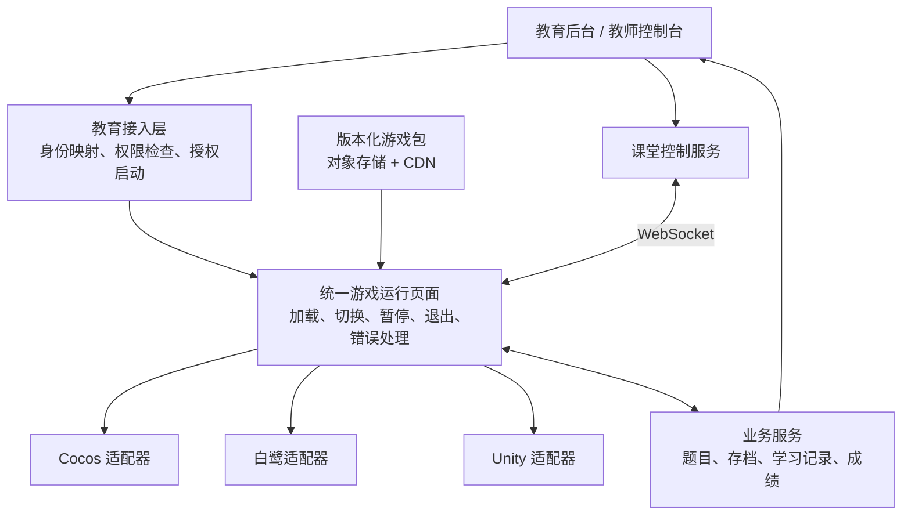

# 教育网页小游戏平台架构方案

> 适用范围：一百多款现有小游戏，主要采用 Cocos、白鹭引擎，其中包含 26 款 Unity 游戏。目标终端为教室电脑大屏浏览器、手机浏览器和平板浏览器。
>
> 文档日期：2026 年 10 月 26 日。
>
> 本文为架构建议。具体改造成本、性能指标和交付排期，应在源码盘点与试点验证后确定。

## 1. 架构建议与方案对比

建议采用 **兼容现有三种引擎的统一游戏平台**，统一登录、权限、启动、课堂控制、存档和成绩；新增游戏以 Cocos 为主，复杂 3D 内容继续使用 Unity。

当前最有价值的投入，是把现有的一百多款游戏变成一套可管理、可运营的教育产品。

### 1.1 可选方案

| 方案 | 具体做法 | 优点 | 主要代价 | 适合程度 |
| --- | --- | --- | --- | --- |
| **A. 多引擎统一接入平台** | 保留 Cocos、白鹭、Unity，各自发布 Web 游戏包，通过统一 SDK 接入平台 | 最大限度复用现有作品，可以分批上线，单款独立更新 | 需要维护三种引擎适配器 | **最推荐，作为第一阶段架构** |
| **B. 逐步向 Cocos 收敛** | 存量先接入；新增 2D、轻量 3D 优先 Cocos；旧项目在大改版时评估迁移 | 后续制作规范、人员和工具更集中 | 白鹭和 Unity 项目迁移仍需重做部分代码、材质或动画逻辑 | **推荐作为长期演进方向** |
| **C. 全面统一 Unity Web** | 把所有游戏逐步迁到 Unity，再统一导出网页版本 | 复杂 3D、角色动画和关卡制作流程较集中 | 大量重写现有 2D 游戏；简单游戏也要承担相应的启动和运行成本 | 适合未来以复杂 3D 为主的业务，目前优先级较低 |
| **D. 本地网页运行＋少量云渲染** | 普通游戏在浏览器运行，极重的 3D 内容在 GPU 服务器运行并串流到浏览器 | 少量大型仿真可以降低终端算力要求 | 持续 GPU 成本、网络依赖和交互延迟；独立操作人数直接影响容量 | 适合作为特殊内容的补充 |

云渲染的典型例子是 Unreal Pixel Streaming：服务器渲染画面和音频，通过 WebRTC 传给浏览器，再接收用户输入。它更适合少量高画质实验、展厅或仿真项目。[Epic 官方说明](https://dev.epicgames.com/documentation/en-us/unreal-engine/pixel-streaming-in-unreal-engine)

### 1.2 推荐演进路线

**先落地方案 A，再按方案 B 演进。**

- 存量 Cocos、白鹭、Unity 游戏先接入统一平台。
- 新增 2D 和轻量 3D 游戏优先使用 Cocos。
- 复杂 3D 或已有成熟 Unity 资产的项目继续使用 Unity。
- 老项目在大改版或维护成本明显上升时，再评估引擎迁移。

## 2. 推荐的总体架构

### 2.1 核心模块与技术建议

| 模块 | 职责 | 建议做法 |
| --- | --- | --- |
| 教育接入层 | 对接教育系统身份、课程、班级、作业和授权 | 统一接口，避免每款游戏分别对接 |
| 游戏运行页面 | 加载当前游戏，处理暂停、切换、退出、加载失败 | Vue 或 React＋TypeScript；优先沿用团队现有技术 |
| 游戏适配器和 SDK | 把三种引擎接成相同的平台协议 | 一套协议，三种适配实现 |
| 游戏包与资源 | 存储代码、模型、贴图、音效等 | 对象存储＋CDN，单款独立发布 |
| 业务服务 | 管理权限、题库、存档、成绩、版本 | 优先复用现有教育后台技术栈 |
| 课堂控制服务 | 教师让在线学生切换游戏、暂停或结束 | WebSocket，配合状态确认和重连 |

### 2.2 后端组织方式

初期建议采用 **模块化单体**：在一个业务系统中划分权限、游戏目录、任务、存档、成绩等模块；静态资源和实时连接可以独立部署。

一百多款游戏本身并不意味着需要微服务。真正影响服务器规模的是：

- 同时在线人数。
- 课堂集中启动量。
- 学习记录和存档写入频率。
- 是否包含实时多人玩法。
- 团队分工、发布频率和故障隔离要求。

## 3. 三种引擎的统一接入

### 3.1 运行容器

每款游戏保留独立的 Web 构建产物，由统一运行页面加载。

对于已有多个引擎和版本的情况，**独立页面／iframe 是比较务实的起点**，可以减少全局变量、依赖和页面样式互相影响。

每次只保留一个正在运行的游戏实例，切换流程为：

> 保存当前进度 → 暂停游戏 → 停止音频和输入 → 释放资源 → 卸载页面 → 加载下一款。

iframe 提供独立页面环境，实际进程分配和内存回收仍由浏览器管理，需要做连续切换测试。

### 3.2 引擎适配方式

| 引擎 | 接入方式 | 注意事项 |
| --- | --- | --- |
| Cocos | 在项目中加入 JS／TS SDK，包装初始化、暂停、存档等能力 | 先区分 Cocos2d-JS、Creator 2.x、Creator 3.x；保留对应构建环境 |
| 白鹭 | 加入兼容旧构建链的 SDK，通过游戏主入口连接平台 | 固定引擎及依赖版本，逐款检查音频、资源加载和触屏适配 |
| Unity | 网页 JS 与 Unity C# 之间建立桥接，再接统一 SDK | 浏览器调用 Unity 可使用 `SendMessage`；反向调用采用对应版本的 JS 插件接口 |

Cocos 官方提供 Web Mobile、Web Desktop 发布能力；白鹭本身也是 HTML5 游戏引擎。现有可正常发布的项目可以直接进入适配流程。

参考：[Cocos 发布文档](https://docs.cocos.com/creator/3.8/manual/en/editor/publish/index.html)、[白鹭官方源码仓库](https://github.com/egret-labs/egret-core)、[Unity 浏览器通信文档](https://docs.unity.com/en-us/engine/6000.5/manual/platform-specific/webgl/develop/interactingwithbrowserscripting/web-interacting-browser-unity-to-js)。

### 3.3 统一 SDK 最小接口

以下接口名称为建议，最终应形成带版本号的正式协议。

| 方向 | 接口示例 | 作用 |
| --- | --- | --- |
| 平台 → 游戏 | `init(context)` | 注入课程、任务、关卡、画质等上下文 |
| 平台 → 游戏 | `start / pause / resume` | 开始、暂停、继续 |
| 平台 → 游戏 | `changeLevel / dispose` | 切关及退出清理 |
| 游戏 → 平台 | `ready / error` | 通知加载完成、运行错误 |
| 游戏 → 平台 | `saveProgress / complete` | 保存进度、报告完成 |
| 游戏 → 平台 | `submitAnswer / reportEvent` | 提交答题和学习事件 |
| 游戏 → 平台 | `requestExit` | 请求返回课程 |

**包装层只能控制游戏已经暴露的能力。** 如果旧游戏没有暂停、存档或切关接口，就需要改动游戏内部逻辑，单纯在外面套一个网页无法完整补齐这些功能。

## 4. 教育后台权限控制与授权启动

### 4.1 权限模型

建议采用“角色＋业务条件”的权限模型。

角色可包括平台管理员、学校管理员、教师和学生。一个学生能否进入某款游戏，需要同时满足相应的业务条件，例如：

- 属于正确的学校、班级和课程。
- 学校购买或获准使用这款游戏。
- 教师已经布置对应任务。
- 当前处于开放时间内。
- 剩余次数、使用时长或前置任务符合要求。

权限检查放在服务端，至少覆盖 **启动、获取受保护题目、读取存档、提交成绩、接受课堂控制** 这些入口。

用户、学校和班级身份来自已验证的会话，不能相信游戏通过 URL 自行传来的身份参数。

示例：

> 学校购买了“数学闯关”，教师只向三年级二班开放第 3 关，开放时间是本节课。学生从收藏夹访问同一个游戏地址时，后台仍会重新检查班级、任务和时间。

### 4.2 自建教育后台的启动流程

1. 学生在课程中点击“开始游戏”。
2. 教育后台后端向游戏平台申请启动。
3. 游戏平台检查身份映射和业务权限。
4. 生成一个短时、一次性的启动票据，绑定学生、学校、任务、游戏和关卡。
5. 浏览器把票据交给统一运行页面。
6. 平台消费票据，创建范围受限的游戏会话，并加载指定版本。
7. 游戏完成后，由平台后端同步成绩和完成状态。

票据有效期可以先以 **30～60 秒**作为设计起点，消费必须原子化，避免重复使用。

长期访问令牌不应放在 URL 中；返回课程的地址采用预登记目标或精确白名单。身份系统支持 OIDC 时，应采用成熟的授权码流程，并按客户端类型使用 PKCE。[OAuth 安全最佳实践 RFC 9700](https://www.rfc-editor.org/rfc/rfc9700.html)

### 4.3 权限撤销与离线边界

- 在线用户可以通过服务端拒绝请求、推送通知和定期检查，实现约定时间内生效。
- 严格要求撤权的场景，可以在短期授权到期且无法联网校验时暂停。
- 允许断网续玩的场景，需要接受离线终端无法立即收到撤权通知，并在补交记录时重新校验。

已经下载到浏览器的代码和素材存在可复制的边界。平台应重点控制正式授权、受保护内容、在线能力和可信成绩。

### 4.4 标准 LMS 接入

如果未来需要接入其他学校的标准 LMS，可以增加 **LTI 1.3** 适配，具体取决于 LMS 支持情况：

| 能力 | 对应标准 |
| --- | --- |
| 启动身份和课程上下文 | LTI 1.3 |
| 教师选取游戏资源并放入课程 | Deep Linking |
| 成绩回传 | Assignment and Grade Services，简称 AGS |

参考：[LTI 1.3](https://www.imsglobal.org/spec/lti/v1p3)、[Deep Linking](https://developers.imsglobal.org/spec/lti-dl/v2p0)、[AGS 成绩服务](https://www.imsglobal.org/spec/lti-ags/v2p0/)。

## 5. 教育系统远程跳转与课堂控制

### 5.1 三类能力

| 能力 | 使用例子 | 实现方式 |
| --- | --- | --- |
| 免登录进入指定内容 | 点击课程里的按钮，进入某游戏第 3 关 | 单点登录／启动票据＋游戏、任务、关卡参数 |
| 教师实时切换 | 教师点击“全班进入下一款游戏” | 已打开的运行页面维持 WebSocket 控制连接 |
| 完成后返回或继续 | 游戏结束后回到课程，或进入下一个任务 | 游戏报告完成，由平台决定后续流程 |

### 5.2 实时课堂控制流程

> 教师发布任务 → 服务端检查教师和班级权限 → 向在线学生发送命令 → 学生端保存并切换 → 返回执行结果 → 教师端显示成功、失败和离线人数。

控制协议至少需要：

- 每条命令有唯一 ID、目标课堂会话、有效期和顺序号。
- 区分“已收到”和“已执行成功”。
- 重复命令不会导致重复启动、重复提交。
- 断线重连后获取课堂当前状态，避免执行已经过时的跳转。
- 命令传递 `gameId / levelId / assignmentId`，由平台映射真实入口。

WebSocket 适合这种双向控制与确认。[MDN WebSocket 文档](https://developer.mozilla.org/en-US/docs/Web/API/WebSockets_API)

### 5.3 浏览器与跨域限制

**控制范围是已经打开、已接入且在线的页面。** 普通网页后台无法直接操纵学生尚未打开的浏览器页面；音频播放、全屏等能力也受浏览器策略约束，需要设计首次点击进入课堂的交互。[浏览器自动播放策略](https://developer.mozilla.org/en-US/docs/Web/Media/Guides/Autoplay)

如果游戏嵌在教育系统中：

- 跨域通信使用 `postMessage`，校验来源、窗口和消息结构。
- 嵌入登录需要处理第三方 Cookie 限制。
- 域名条件允许时可设计同站部署，否则提供顶层页面启动方案。
- 在目标浏览器上验证登录、存储、音频和全屏行为。

参考：[postMessage 文档](https://developer.mozilla.org/en-US/docs/Web/API/Window/postMessage)、[第三方 Cookie 说明](https://developer.mozilla.org/en-US/docs/Web/Privacy/Guides/Third-party_cookies)。

## 6. 26 款 Unity 游戏的处理策略

Unity 是本项目需要优先验证的部分，尤其是手机和平板。

当前 Unity 官方已经列出部分移动浏览器支持，具体项目仍然取决于使用的 Unity 版本、插件、构建设置、资源规模和设备。旧项目需要按其版本核查。[Unity 官方浏览器兼容性](https://docs.unity.com/en-us/engine/6000.3/manual/platform-specific/webgl/intro/browsercompatibility)

### 6.1 按实测结果分级

| 分组 | 实测结果 | 处理策略 |
| --- | --- | --- |
| A 类 | 电脑、手机、平板均能达到要求 | 保留 Unity，接入 SDK 后上线 |
| B 类 | 电脑表现好，移动端加载慢或卡顿 | 保留 Unity，制作移动画质档、精简首场景和资源 |
| C 类 | 关键插件无法 Web 化，或移动优化成本明显偏高 | 单独评估替换插件、重做部分功能，或为移动端制作轻量版本 |

### 6.2 单款检查清单

- 源码和引擎版本能否完整构建。
- 是否依赖原生插件、文件系统或不适用的网络接口。
- 手机触屏能否完成所有操作。
- 横竖屏、软键盘、浏览器工具栏变化是否影响界面。
- 首次可玩时间、峰值内存、连续运行表现。
- 纹理、阴影、粒子、后处理是否有移动档。
- 暂停、切关、退出和重新进入是否稳定。

Unity Web 的压缩发布还需要服务器正确配置 `Content-Encoding` 等响应头，部署配置也会影响加载表现。[Unity Web 部署文档](https://docs.unity.com/en-us/engine/6000.5/manual/platform-specific/webgl/building-distribution/deploying)

### 6.3 多终端适配

对于同一款游戏，可以共用玩法和学习数据，分别使用电脑、手机、平板的资源或画质配置。

教室大屏可以采用较低的内部 3D 渲染分辨率，同时保持文字 UI 清晰。

## 7. 打击感与内容质量规范

Cocos、白鹭、Unity 都可以制作有表现力的游戏。最终手感主要来自输入、动画、判定、音效、特效和性能的配合。

### 7.1 可复用制作规范

| 项目 | 具体要求 |
| --- | --- |
| 输入响应 | 键鼠和触屏分别调优，操作反馈及时 |
| 动作节奏 | 攻击前摇、命中时刻、收招、连击衔接一致 |
| 命中判定 | 攻击范围与受击范围清楚，避免视觉命中却无反馈 |
| 受击表现 | 受击动作、击退、短暂停顿按玩法组合 |
| 声音与特效 | 命中音效、粒子、镜头反馈在同一节奏上触发 |
| 性能 | 按设备限制粒子、阴影、后处理和渲染分辨率 |
| 教学体验 | 支持减弱震动、关闭闪光、独立音量，题目和提示清晰 |

普通单人小游戏的操作和命中表现应在本地及时响应，埋点、存档等后台请求异步处理。正式教育判分和关键成绩规则由后端校验。

### 7.2 学习数据与表现分

建议将 **游戏分数与学习成绩分别建模**。

例如，击中目标获得的表现分、答题正确率、知识点掌握度，可以分别记录，避免后续教育报表难以解释。

### 7.3 批量内容生产

相似玩法可以共享模板，再替换题库、关卡和素材；动作反馈组件也可以共享参数规范。

具体能归并多少模板，需要先看实际玩法清单。

## 8. 上百款游戏的发布和运行管理

### 8.1 游戏资源登记

每款游戏建立一条完整的资源记录，至少包括：

- 游戏 ID。
- 引擎及版本。
- 游戏版本。
- SDK 协议版本。
- 游戏入口。
- 支持设备。
- 横竖屏要求。
- 存档结构版本。
- 暂停、切关等能力。

### 8.2 发布与缓存策略

- **单款独立发布、独立回滚。**
- 游戏包版本不可变，资源带内容哈希。
- 正在运行的会话固定游戏版本，避免中途混入新资源。
- 只加载当前游戏，按预算预取下一关或下一款。
- 游戏版本、题目版本、存档结构版本分别管理。
- 授权接口和个人数据采用独立于静态资源的缓存策略。
- 学习事件带唯一 ID，失败可重试，重复提交保持幂等。
- 教育后台暂时不可用时，成绩同步有重试和可查询状态。

Cocos 的 Asset Bundle 可以用于资源拆包、远程加载及按需释放；其他引擎也需要制定对应的资源策略。[Cocos Asset Bundle 文档](https://docs.cocos.com/creator/3.8/manual/en/asset/bundle.html)

### 8.3 教室集中启动的网络容量

教室集中启动需要测真实网络。例如：

> 40 台设备各首次下载 20 MB，共需传输约 800 MB。假设共同使用一条 100 Mbps 出口，理想情况下仅传输就至少需要约 64 秒，实际还会受到协议开销及其他流量影响。

因此，需要同时考虑：

- 首场景拆分。
- 课前预热。
- 错峰加载。
- 条件允许时的校内边缘缓存。

### 8.4 运行监控

重点关注：

- 加载失败。
- 黑屏。
- 渲染上下文丢失。
- 卡顿。
- 切换失败。
- 存档失败。
- 成绩回传失败。

监控记录应带上游戏版本及设备信息，以便定位具体问题。

## 9. 推进步骤与验收标准

### 9.1 资产盘点

先做完整资产清单，重点确认源码、引擎版本、现有 Web 构建、插件和目标设备支持情况。

### 9.2 三款试点

| 试点 | 选择建议 | 主要验证内容 |
| --- | --- | --- |
| Cocos | 一款有动作和命中反馈的游戏 | SDK、手感、键鼠与触屏、画质档 |
| 白鹭 | 一款有代表性且存在适配难点的游戏 | 老构建链、资源、音频、生命周期 |
| Unity | 26 款中较复杂的一款 3D 游戏 | 手机和平板性能、加载、内存、JS 桥接 |

如果新增 3D 准备主要使用 Cocos，再补一款 Cocos 3D 样板。

三款试点都需要完成以下链路：

**授权进入 → 指定关卡 → 教师暂停／切换 → 存档 → 完成 → 成绩回传 → 返回课程。**

### 9.3 建议验收标准

下表为建议起点，具体数值应绑定样机和网络条件后确定，不构成对所有游戏的性能保证。

| 维度 | 建议验收方式 |
| --- | --- |
| 流畅度 | 主流目标设备争取稳定 60 FPS；约定低配设备降档后稳定 30 FPS，同时观察明显卡顿 |
| 启动速度 | 测“点击到实际可操作”的时间，分别统计首次访问和缓存命中 |
| 连续切换 | 连续切换 20 次，内存趋于稳定，无残留声音、重复输入和明显性能衰减 |
| 课堂控制 | 教师端能看到执行成功、失败和离线状态 |
| 权限 | 验证越权访问、票据重放、跨学校数据访问、权限撤销 |
| 数据 | 验证断线重试和重复提交，成绩不重复、任务状态可追踪 |
| 设备覆盖 | 学校实际电脑与浏览器、Android 手机和平板、iPhone／iPad 真机 |

### 9.4 批量推进

试点结束后，根据实测结果固化：

- 三种引擎适配模板。
- SDK 文档和协议版本。
- 游戏制作及质量规范。
- 发布流水线。
- 验收清单。

之后按小批次推进剩余游戏。**开发报价和排期应以试点暴露的真实改造量为依据。**
